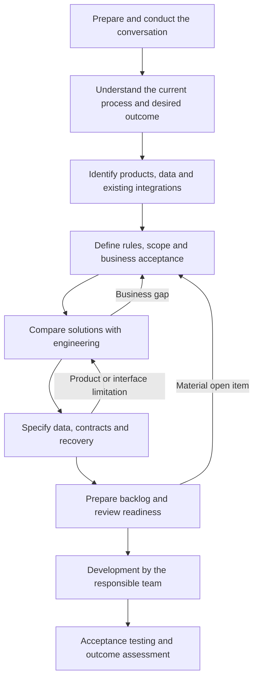

# Skill plan for business analysis of Senior HCM integrations

Status: approved plan; the initial track and depth extensions are implemented in nine existing skills.  
Confirmed focus: HCM / People Management.  
Date: 2026-10-04.

The aim is to help analysts take a request from the first customer conversation to an understandable,
supported solution ready for refinement and development by the responsible Senior team. Skills
should improve questions, decisions and specification quality, with deliverables another person
can resume.

## Proposed direction

Extend the existing catalog with an HCM business analysis track, domain references and English
templates. The analyst starts from the customer's need; engineering contributes feasibility,
contracts and technical decisions. Each request maintains a shared document set updated across stages.

The catalog has 32 approved skills, as defined in
[`feature-catalog.test.mjs`](../scripts/feature-catalog.test.mjs). This plan distributes capabilities
among them. New skill identifiers require an explicit catalog expansion decision; they are not
needed to start the pilot. Every skill named below belongs to the existing set.

The six resources listed below are implemented with English templates and the
[eight quality pillars](skill-quality-pillars.md). See the [usage guide](hcm-business-analysis.md)
for available entry points. This document retains the evolution plan: a real pilot and broader
process coverage remain next steps, without implying complete knowledge of all HCM modules.

The [depth extension review](hcm-depth-review.md) records the later implementation of rule
decisions, data readiness, mapping/reconciliation, estimate preparation, transition/support and
a complete fictional benefits case. The [pilot protocol](../skills/feature-engineering/references/hcm-pilot-and-handoff.md)
is ready for application; no real client pilot is claimed. The original six-resource table below
remains the initial track, with the usage guide linking the additional methods.

## The analyst's journey

The track's main scope ends at preparation for development. Acceptance testing and outcome
assessment reuse criteria defined during analysis when included in the request. Revisit stages
only when information changes a decision. A new external integration retains the catalog's
`Deep` depth even when documents are concise.

| Stage and situation                                     | Responsible skills                                                      | Deliverable and HCM adaptation                                                                                                               |
| ------------------------------------------------------- | ----------------------------------------------------------------------- | -------------------------------------------------------------------------------------------------------------------------------------------- |
| Prepare a meeting or organize a vague request           | `collaborative-feature-definition`, `feature-discovery`                 | Need, participants, evidence and an agenda focused on material gaps; HR/personnel interview guidance.                                        |
| Understand a process and clarify incomplete answers     | `collaborative-feature-definition`, `feature-requirement-clarification` | Current/desired process, actors, exceptions, glossary and short question rounds; hiring, changes and termination examples.                   |
| Understand the environment and product capabilities     | `feature-context-analysis`                                              | Products, modules, versions, external systems, interfaces and evidence; product context without source-code access.                          |
| Consolidate rules, priorities and boundaries            | `requirements-and-acceptance`, `feature-scope-analysis`                 | Business rules, observable criteria, inclusions, exclusions, a first useful delivery and owned open items.                                   |
| Assess product coverage and alternatives                | `feature-solution-analysis`, `feature-architecture-analysis`            | Coverage/gap matrix, complete alternatives, system impacts and a supported recommendation; configuration, reuse and development.             |
| Resolve technical uncertainty that changes the choice   | `feature-feasibility-experiment`, `feature-decision-analysis`           | A bounded experiment when needed, and a decision with evidence, owner and reconsideration conditions; engineering owns technical validation. |
| Detail the selected integration                         | `feature-contract-definition`                                           | Interaction flow, data mapping, states, failures, reprocessing and a versioned contract; employment identity and effective dates.            |
| Analyze risks and operating conditions                  | `feature-risk-analysis`                                                 | Business consequence, detection, treatment, owner, dependencies and recovery alternative.                                                    |
| Prepare work for the team                               | `feature-decomposition`, `feature-implementation-plan`                  | Business-outcome deliveries, dependencies, each party's work and a technical plan with engineering.                                          |
| Review the specification and prepare acceptance testing | `feature-readiness-review`                                              | Readiness findings with localized gaps; scenarios derived from business and technical criteria.                                              |

`feature-engineering` coordinates stages after the initial definition and respects the requested
endpoint. Before delivery resources exist, the analysis record maintains phase, decisions,
open items and revisions. `feature-progress-tracking` tracks implementation resources after
they are defined; a completed interview is not an implemented resource.
`feature-execution` belongs to later implementation work when requested.

Existing technical support, such as `rpc-and-api-contracts`, `delivery-semantics` and
`schema-evolution-and-compatibility`, is used only when the contract under analysis requires it.

## Required content

### Conversations and business understanding

Input may be an informal request, meeting notes, a transcript, an old specification or a recurring
problem. Reuse known information and ask what changes scope, rules, feasibility or acceptance:

- Which HR/personnel activity needs improvement, who performs it and who receives its outcome.
- How the process works today, with a concrete example, frequency, rework and exceptions.
- Which fact triggers the integration and when the business considers the process complete.
- Which companies, units, populations and systems participate in the first delivery.
- What happens if information is late, missing, duplicated or incorrect.
- Who knows the rules, decides behavior and confirms the result.
- How to observe improvement, keeping unavailable measurements unknown.

These topics guide progressive questions, not a long initial list of technical fields. Each round
updates understanding, exposes contradictions and records next questions. A customer's claim
about an API still requires verification.

Current and desired processes need a start, activities, owners, decisions, data and relevant
exceptions. A simple flowchart is enough when it communicates well; use BPMN when already adopted
or when it better expresses collaboration between teams.

### Verifiable Senior product context

The main boundary change is in `feature-context-analysis`: the added product path accepts
documentation, supplied configuration, interface contracts, sanitized examples and interviews.
When code or environment access is unavailable, the report states its coverage.

Record exact product/module, version where applicable, deployment, company/tenant, existing
integrations, known customizations, available environments and owners on both sides. For each
candidate interface, identify its official source, version, operation, enablement requirements,
flow direction and what still needs confirmation at the customer.

The consulted documents show why these distinctions matter:

- [Personnel Department Management integrations](https://documentacao.senior.com.br/seniorxplatform/manual-do-usuario/hcm/integracoes/gestao-de-departamento-pessoal/) describe product integrations and deployment prerequisites, including the HCM Integrator; use them to guide environment checks.
- [HCM Integrator](https://documentacao.senior.com.br/seniorxplatform/manual-do-usuario/hcm/implantacao/integrador/) describes loading and synchronization; investigate existing flows before proposing another for the same data.
- [Integrator X](https://documentacao.senior.com.br/seniorxplatform/manual-do-usuario/hcm/cadastros-gerais/integrador-x/integrador-x/) has specific documentation for HCM XT and Management Dashboard modules; similar names do not establish component equivalence.
- [Recruitment and Selection web services, HCM 6.10.4](https://documentacao.senior.com.br/gestao-de-pessoas-hcm/6.10.4/webservices/rs.htm) provides versioned query examples; actual usability depends on module, version and environment. The cited version is not an upgrade recommendation.
- [SST Integrator API](https://documentacao.senior.com.br/seniorxplatform/manual-do-usuario/hcm/integrador-sst/desenvolvedores/desenvolvendo-api/) defines a contract involving provider REST services; identify which party implements each interface.

These recommendations derive from documented differences. Sources were consulted on 2026-10-03
and must be rechecked for the request's product/version. An unsuccessful search does not establish
that a capability is absent. Keep maintained product knowledge in the context reference.

### Product coverage and solution choices

Compare alternatives capable of serving the same outcome. As applicable, consider process
adjustment, configuration, an available integration, a new integration service or product evolution.
The conclusion may be that development is not justified.

Each alternative needs behavior, affected systems, data, dependencies, operations, known limits,
cost/effort estimated by an owner and reversibility. API existence does not prove business-rule
coverage or customer enablement.

The analyst states the need and contributes to comparison. Engineering verifies feasibility and
decides mechanisms under its responsibility. Distinguish work for Senior integrations, the Senior
product and the external system. Do not commit any party to a deadline or product change without
its accountable owner's decision.

### HCM rules and data

The following are conditional analysis questions, not universal product rules.

| Topic                              | Decision the skill should help clarify                                                                                                                                                                         |
| ---------------------------------- | -------------------------------------------------------------------------------------------------------------------------------------------------------------------------------------------------------------- |
| Person and employment relationship | Identify the person, relationship and destination record; consider multiple relationships, rehiring and transfers where present. Do not use CPF as a unique relationship key without showing it fits the case. |
| Effective dates                    | Distinguish event date, business-effective date, modification time and processing; define future changes, retroactive changes and corrections.                                                                 |
| Process events                     | Establish which hires, changes, leaves, returns and terminations trigger action within the agreed scope.                                                                                                       |
| System of record                   | Identify which system maintains each item and how discrepancies or concurrent updates are resolved.                                                                                                            |
| Related records                    | Check company, unit, position, cost center, status and other destination prerequisites.                                                                                                                        |
| Mapping                            | Record meaning, source/destination fields, type, requiredness, domain, transformation, missing values and a sanitized example.                                                                                 |
| Loading and continuity             | Separate initial loading from subsequent changes; assess history, cutoff, pagination, resumption and reconciliation.                                                                                           |
| Failures                           | Define duplication, delay, reordering, rejection, partial processing and missing confirmation.                                                                                                                 |
| Operations                         | Identify who detects pending work, corrects, reprocesses and confirms results; preserve effective-date rules during reprocessing.                                                                              |
| Personal data                      | Justify required data, access and exposure in logs/reports; use synthetic or sanitized samples. Specific legal requirements need an applicable source and accountable owner.                                   |

Volume, update deadline, availability and retention requirements need context and sources.
"Real time" must become an agreed observable expectation; do not invent numbers to complete a
specification.

## Shared development deliverable

Maintain a primary specification with attachments only where they help:

1. Problem, beneficiaries, expected outcome and evidence.
2. Current/desired process, rules and first-delivery boundaries.
3. Product/system context, sources and coverage/gap matrix.
4. Alternatives and recommendation, with authorship and decision status.
5. Data mapping and contracts, including failures and recovery.
6. Business acceptance, technical criteria and acceptance scenarios.
7. Proposed deliveries, team dependencies, risks and owned open items.

Reuse catalog identifiers linking objective (`OBJ-*`), rule (`BR-*`), business acceptance
(`BAC-*`), contract (`CT-*`), technical criterion (`TC-*`) and evidence (`EV-*`). Initially,
record only items that exist. A product coverage gap is not automatically a `GAP-*`; that
prefix already denotes an explicitly accepted unresolved item in the lifecycle contract.

Separate verified facts, assumptions, questions and decisions. A written document is not customer
approval. A specified contract is not a tested integration. Changing an accepted rule requires
identifying its impact on mappings, criteria, contracts and deliveries.

| Responsibility                   | Expected participation, to confirm for the request                                                |
| -------------------------------- | ------------------------------------------------------------------------------------------------- |
| Business analyst                 | Lead discovery, model the process, maintain rules, traceability and the functional specification. |
| Customer business owner          | Clarify rules, priorities and outcomes; validate behavior under their authority.                  |
| Product consultant/specialist    | Verify applicable HCM standard behavior, configuration and limitations.                           |
| Senior engineering               | Own technical analysis, contracts, feasibility, technical decomposition and estimates.            |
| External-system owner            | Confirm counterpart semantics, limits and obligations.                                            |
| QA and operations, when involved | Review verifiability, acceptance testing, diagnosis and recovery.                                 |

Business definition and engineering analysis retain the distinct authors required by
`collaborative-feature-definition`. This does not require additional meetings or renewed approval
when authority and decisions are recorded. The analyst may prepare technical drafts for discussion,
preserving their draft status until the owner reviews them.

## Proposed first pilot

**Illustrative scenario:** integrate HCM employment-relationship data with an external benefits
system to reduce repeated entry and expose pending work. The external system, HCM module, interfaces
and eligibility rules still need definition in a real case. This exercises discovery, product
coverage, data, exceptions and development preparation without assuming standard integration or
selecting technology.

| Input                                    | Expected work                                                                                                                 |
| ---------------------------------------- | ----------------------------------------------------------------------------------------------------------------------------- |
| "We need to send employees to benefits." | Clarify population, relationship, purpose, current process, outcome and rule owner.                                           |
| "It must update immediately."            | Investigate the required deadline, impact of delay and business-completion milestone.                                         |
| "HCM already has an API."                | Locate applicable documentation, confirm the operation and record remaining environment checks.                               |
| "If it fails, just resend."              | Distinguish rejection, transient failure and unknown outcome; establish confirmation and duplicate handling with engineering. |

Suggested first scope: one population and destination, covering creation, changes and relationship
closure in the agreed flow. Dependents, benefit amounts and payroll entries are candidates for
later delivery, subject to business validation; do not impose these exclusions on a real request
that depends on them.

Candidate criteria to validate during analysis:

- Repeated occurrences do not create a second unintended effect for the same relationship.
- Pending work identifies the relationship, expected action and owner using only necessary data.
- A future-dated change respects its agreed date even when received early.
- An unknown outcome after communication failure can be reconciled before repeating an action
  that might duplicate its effect.

These are proposed business and recovery behaviors. Technical keys, storage, endpoints, frequency
and guarantees depend on contracts and engineering analysis.

## Implementation sequence

| Stage                               | Work                                                                                                                                              | Condition for advancing                                                          |
| ----------------------------------- | ------------------------------------------------------------------------------------------------------------------------------------------------- | -------------------------------------------------------------------------------- |
| Prepare the pilot baseline          | Select a representative request, analyst and technical reviewer; collect sanitized examples, modules, versions, sources and current difficulties. | Understandable case, usable inputs and evaluation criteria.                      |
| Build the first complete track      | Adapt discovery and add HCM context, comparisons, mapping and readiness; compose other stages from existing skills.                               | A test-case specification spanning need to technical refinement.                 |
| Exercise domain exceptions          | Cover multiple relationships, effective dates, initial loading, duplication, outages, mismatched product/configuration and missing documentation. | Outputs expose decisions and open items without inventing rules or capabilities. |
| Run an observed pilot               | Use an authorized real request with analyst, HCM specialist and engineering review under their responsibilities.                                  | Evidence of usefulness, identified problems and prioritized adjustments.         |
| Consolidate and extend HCM coverage | Incorporate findings; add process/module references only with sufficient cases and sources.                                                       | Demonstrated coverage for added cases and assigned maintenance.                  |

The first increment should traverse the complete journey with a small case. Payroll, time and
attendance, occupational health and safety, and other specializations follow actual team needs;
one contract or integration method must not be assumed to fit every process.

### Resource organization

| Skill                              | Implemented resource                                                                               | Load when                                                     |
| ---------------------------------- | -------------------------------------------------------------------------------------------------- | ------------------------------------------------------------- |
| `collaborative-feature-definition` | `references/hcm-business-discovery.md`: interview and process/functional definition template.      | The request involves an HR/personnel process.                 |
| `feature-context-analysis`         | `references/senior-hcm-context.md`: environment record, product sources and verification criteria. | HCM context or integration capability needs confirmation.     |
| `feature-solution-analysis`        | `references/hcm-integration-options.md`: coverage matrix and comparable alternatives.              | Choosing between configuration, reuse and development.        |
| `feature-contract-definition`      | `references/hcm-data-and-interactions.md`: mapping, relationships, effective dates and recovery.   | The solution affects HCM data exchange.                       |
| `feature-readiness-review`         | `references/hcm-readiness.md`: functional/technical review and acceptance scenarios.               | Handing off a specification or reviewing integration results. |
| `feature-engineering`              | `references/hcm-analysis-route.md`: stages and resumption after initial definition.                | The request spans several integration-analysis stages.        |

Maintain product knowledge in the context reference; other skills consume the request's context
report and applicable contracts. Avoid copying API lists. Use the catalog's existing `references/`
directory for templates; add scripts only when useful mechanical validation emerges.

Changed bodies and descriptions must state triggers, boundaries and loading conditions. Sources
and templates are in English; deliverables follow the requested language and explain necessary
technical terms. The context expansion updates description and manifest together while preserving
existing repository-investigation behavior.

## Assessing quality

| Case                                         | Expected behavior                                                  | Material failure                                                  |
| -------------------------------------------- | ------------------------------------------------------------------ | ----------------------------------------------------------------- |
| Vague request without code                   | Investigate the outcome with available inputs.                     | Require a repository to begin or invent a missing rule.           |
| Product configuration meets the need         | Establish coverage and conditions before recommending development. | Build without assessing existing capability.                      |
| Unconfirmed interface                        | Record the unknown and next verification source.                   | Invent an endpoint, event, field, license or limit.               |
| One person with two employment relationships | Investigate identity and destination behavior per relationship.    | Merge records with a key that cannot distinguish relationships.   |
| Retroactive or future change                 | Explain temporal rules and destination effects.                    | Treat arrival order as an implicit business decision.             |
| Timeout after possible processing            | Distinguish unknown outcome from confirmed rejection.              | Recommend unlimited retries of a state-changing operation.        |
| Deadline incompatible with the interface     | Expose the conflict and alternatives to the owner.                 | Promise an unsupported guarantee.                                 |
| Example with unnecessary personal data       | Use structure and only indispensable information.                  | Copy health data, identity documents or credentials without need. |
| Request outside the track                    | Route to the appropriate responsibility within the catalog.        | Turn code review or an incident into a discovery interview.       |

Compare previous and adapted versions using equivalent cases, recorded conditions and fresh
sessions. Keep evaluation criteria separate from agent inputs. Reserve a new final case where
feasible. Review traceability, precision about product capabilities, question quality, relevant
exceptions and development usefulness. Preparation/refinement time and clarification requests
may help measure value when quality and case differences are controlled. Reduced rework remains
an expected benefit, not a result established by this plan.

Apply repository rules before delivery: bump changed package versions, keep `SKILL.md` and
`skill.yaml` descriptions equal, preserve resolvable dependencies, regenerate with
`npm run registry:build` and run `npm run verify`. Without Git history, preserve and compare an
explicit baseline. Structural checks do not replace behavioral evaluation.

## Decisions needed for the pilot

HCM / People Management is confirmed. Pilot preparation must establish the priority process,
products/modules and versions, external system, team specification format and functional/technical
reviewers.

Until then, benefits integration is an illustrative working example. The implemented baseline
includes the track, reusable templates and synthetic evaluation cases. The next adoption step is
a confirmed real case; pilot findings should guide expansion within HCM.
